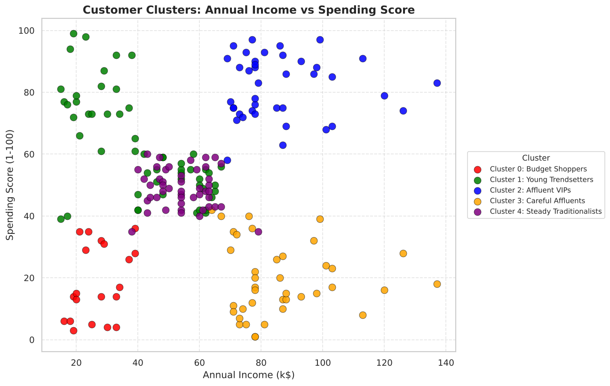
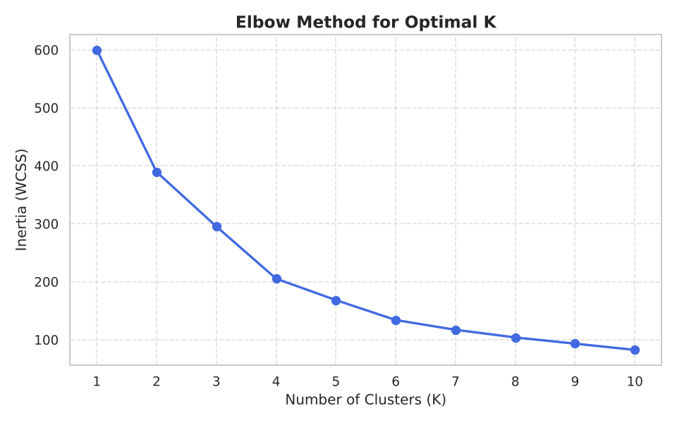
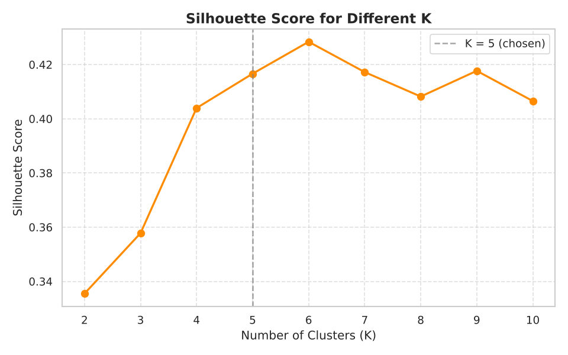
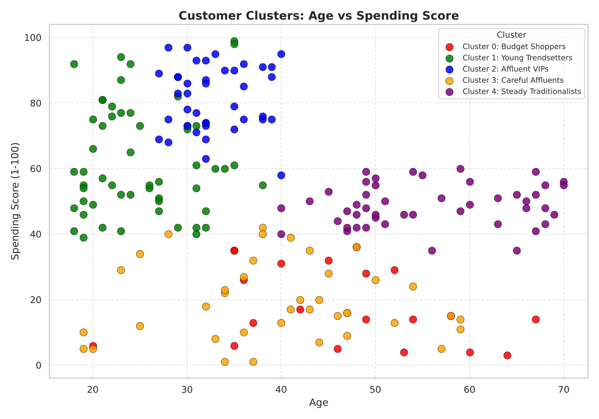

# Customer Segmentation using K-Means Clustering

**Python | Pandas | Scikit-learn | Matplotlib | Seaborn | Jupyter**

Grouping 200 mall customers into 5 segments with unsupervised machine learning, so marketing can be targeted instead of one-size-fits-all.

---

## Key Findings

- **Income alone does not predict spending.** The correlation between Annual Income and Spending Score is almost zero (0.01), so income-based rules would miss the real patterns.
- **K-Means found 5 segments** using Age, Annual Income, and Spending Score (scaled with `StandardScaler`).
- **Two high-income groups behave very differently.** Cluster 2 (Affluent VIPs) and Cluster 3 (Careful Affluents) both average about $86k income, but their average spending scores are 81.5 vs 19.4.
- **Cluster 3 may be the biggest growth opportunity:** 39 high-income customers with low spending scores. The data cannot explain why they spend less, so this should be tested with campaigns.
- **Cluster 1 (Young Trendsetters)** spends more than their income suggests (average age 25, average income $41k, average score 62).



---

## Project Description

A shopping mall sends the same marketing message to every customer, which wastes budget. This project uses **K-Means Clustering** on 200 customers to find groups with similar behaviour, then turns each group into a business persona with a suggested marketing approach.

## Project Objectives

- Load, inspect, and validate the Mall Customers dataset.
- Explore the data with histograms, box plots, and a correlation heatmap.
- Scale features and choose the number of clusters using the Elbow Method and Silhouette Score.
- Fit K-Means, profile each segment, and visualise the clusters.
- Translate the results into business-ready personas.

## Technologies Used

| Technology | Purpose |
| :--- | :--- |
| **Python 3** | Core language |
| **Pandas** | Loading, inspection, cleaning, profiling |
| **Matplotlib / Seaborn** | Histograms, box plots, heatmap, elbow and cluster charts |
| **Scikit-learn** | `StandardScaler`, `KMeans`, `silhouette_score` |
| **Jupyter Notebook** | Step-by-step analysis |

## Dataset

| Field | Value |
| :--- | :--- |
| **File** | `dataset/Mall_Customers.csv` |
| **Source** | Public "Mall Customers" dataset, widely shared on Kaggle |
| **Records** | 200 customers (112 Female, 88 Male) |
| **Missing values / duplicates** | 0 / 0 |
| **Columns** | `CustomerID`, `Gender`, `Age`, `Annual Income (k$)`, `Spending Score (1-100)` |
| **Features used** | `Age`, `Annual Income (k$)`, `Spending Score (1-100)` |
| **Excluded** | `CustomerID` (arbitrary ID), `Gender` (categorical, kept for future work) |

> Spending Score (1-100) is a score assigned by the mall. It is a proxy for spending behaviour, not actual revenue.

## Folder Structure

```text
Customer-Segmentation-Using-KMeans/
├── dataset/
│   └── Mall_Customers.csv
├── notebooks/
│   └── Customer_Segmentation.ipynb   <- 60 cells (26 code), 9 steps
├── outputs/
│   ├── 01_histograms.png
│   ├── 02_boxplots.png
│   ├── 03_correlation_heatmap.png
│   ├── 04_elbow_method.png
│   ├── 05_clusters_income_vs_spending.png
│   ├── 06_clusters_age_vs_spending.png
│   └── 07_silhouette_scores.png
├── .gitignore
├── README.md
└── requirements.txt
```

## Project Workflow

1. **Load** the CSV and confirm 200 rows and 5 columns.
2. **Clean/validate:** 0 missing values, 0 duplicates, 200 unique IDs. The original file is never modified.
3. **EDA:** descriptive statistics, histograms, box plots (2 customers at $137k are the only outliers, in Annual Income), correlation heatmap.
4. **Feature selection:** Age, Annual Income, Spending Score.
5. **Scaling:** `StandardScaler` (K-Means uses Euclidean distance, so features must be on the same scale).
6. **Choosing K:** Elbow Method and Silhouette Score for K = 2 to 10 (see below).
7. **Profiling:** fit K-Means (K = 5) and compute per-cluster averages and ranges.
8. **Visualisation:** two colour-coded scatter plots.
9. **Conclusion:** personas, insights, limitations.

## Choosing K

Neither method gives one exact answer, so K = 5 is a judgement call:

| K | Inertia | Silhouette |
| :-: | :-: | :-: |
| 4 | 205.23 | 0.4040 |
| **5** | **168.25** | **0.4166** |
| 6 | 133.87 | 0.4284 |

- The elbow curve bends gradually around **K = 4 to 6**.
- Silhouette is highest at **K = 6 (0.4284)**. Scores for K = 4 to 10 are all close (about 0.40 to 0.43), which means moderate, not sharp, cluster separation.
- **K = 5** was chosen because it sits in the elbow range, scores close to the best, and gives five clearly different, easy-to-act-on personas. K = 6 is a reasonable alternative to test.




## Results: 5 Customer Segments

| Cluster | Persona | Count | Avg Age | Avg Income | Avg Spending Score |
| :---: | :--- | :---: | :---: | :---: | :---: |
| **0** | Sensible Budget Shoppers | 20 | 46.2 | $26.8k | 18.4 |
| **1** | Young Trendsetters | 54 | 25.2 | $41.1k | 62.2 |
| **2** | Affluent VIP Shoppers | 40 | 32.9 | $86.1k | 81.5 |
| **3** | Careful Affluents | 39 | 39.9 | $86.1k | 19.4 |
| **4** | Steady Traditionalists | 47 | 55.6 | $54.4k | 48.9 |

In the income vs spending chart, four clusters sit in clear corners while Clusters 1 and 4 overlap in the centre. Age separates those two (Cluster 1 is young, Cluster 4 is older):



## Business Insights

1. **High income does not mean high spending.** Clusters 2 and 3 have the same average income but opposite spending scores. Treating them as one group would be a marketing mistake.
2. **Cluster 2 (Affluent VIPs)** has the highest spending scores. VIP experiences and premium brand access are a sensible priority.
3. **Cluster 3 (Careful Affluents)** may be a major growth opportunity. Value-driven campaigns could be tested to see if they lift spending.
4. **Cluster 1 (Young Trendsetters)** spends more than their income suggests. Social media and lifestyle campaigns fit this group.
5. Five targeted campaigns should perform better than one generic message. This needs to be validated with real campaign results.

## How to Run

```bash
git clone https://github.com/PurushothamanS712/Customer-Segmentation-Using-KMeans.git
cd Customer-Segmentation-Using-KMeans
pip install -r requirements.txt
cd notebooks
jupyter notebook
```

Open `Customer_Segmentation.ipynb` and choose **Kernel → Restart & Run All**. The notebook uses relative paths (`../dataset/`, `../outputs/`), so launch Jupyter from the `notebooks/` folder.

## Limitations

- K-Means assumes roughly spherical clusters and needs K to be chosen in advance.
- The choice of K is not clear-cut (see above).
- Only 200 customers and 3 features; Gender is not used.
- Spending Score is a proxy, and the dataset has no visit frequency or purchase history, so the persona descriptions are interpretations, not proven behaviour.

## Future Improvements

1. Add `Gender` (binary encoding) and compare the segments.
2. Try K = 6, DBSCAN, or Gaussian Mixture Models.
3. Use PCA for a single 2D view of all three features.
4. Add features such as visit frequency, product categories, and purchase recency.
5. Build a Streamlit app that assigns a new customer to a segment.
